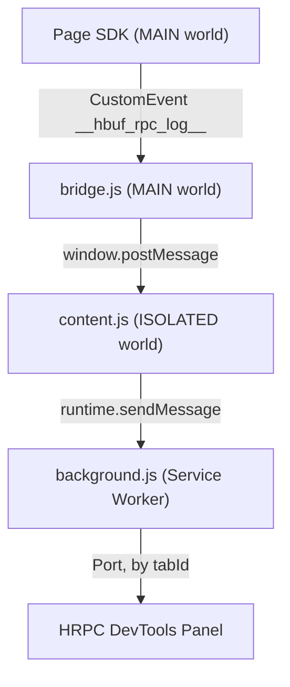

# HBuf RPC Inspector

一个类似 Chrome Network 面板的 Hbuf RPC 调试工具，以 Chrome DevTools 扩展（Manifest V3）的形式运行。

- 版本：1.3.0
- 运行时：Chrome DevTools Extension (MV3)
- 依赖：无（纯原生实现，零依赖）

## 功能特性

- **实时捕获**页面中的 Hbuf RPC 请求（HTTP / WebSocket 双通道）
- **类 Network 面板的请求列表**：状态、方法、名称、类型、耗时、开始时间
- **过滤**：按 path / traceId 关键字过滤；按传输类型（All / HTTP / WebSocket）过滤
- **详情抽屉**：Headers（General + Request Headers 可折叠分组）、Payload、Response 三个标签页
- **JSON 折叠树**：语法高亮、节点展开/收起状态记忆
- **一键复制**：复制载荷 / 复制响应 / 复制 Path（按钮 + 右键菜单）
- **键盘导航**：↑ / ↓ 切换条目，Esc 关闭详情或菜单
- **拖拽**调整左右分栏宽度
- 暗色主题

## 架构



各模块职责：

| 文件 | 职责 |
|------|------|
| `bridge.js` | MAIN world 桥脚本，监听 SDK 的 `__hbuf_rpc_log__` 自定义事件，通过 `window.postMessage` 转发给 content script |
| `content.js` | ISOLATED world content script，向页面注入桥脚本，并将日志转发给 background |
| `background.js` | MV3 Service Worker 消息中枢，按 tabId 将日志转发给已连接的 HRPC 面板端口 |
| `devtools.js` | 创建 `HRPC` DevTools 面板，将 tabId 通过 query string 传入 |
| `panel.html/css/js` | 面板 UI 与交互逻辑 |

## 安装

1. 打开 `chrome://extensions`
2. 开启右上角「开发者模式」
3. 点击「加载已解压的扩展程序」，选择本项目 **`src/` 目录**（`manifest.json` 所在目录）
4. 打开目标页面，按 F12 打开 DevTools，切换到 `HRPC` 面板即可

## 页面 CSP 要求

`bridge.js` 通过 `<script src=chrome.runtime.getURL("bridge.js")>` 注入页面 MAIN world，因此页面的 CSP `script-src` 必须放行扩展源：

```
script-src 'self' chrome-extension://<扩展ID>/ ...
```

未放行时，页面控制台会出现警告：

```
[HBuf RPC Inspector] Failed to inject bridge.js: the page CSP does not allow the extension origin. ...
```

验证注入是否成功：在页面 console 执行 `window.__HBUF_RPC_CONTENT__`，返回 `true` 表示桥脚本已注入。

## SDK 接入

页面侧 SDK 通过自定义事件上报日志：

```js
window.dispatchEvent(new CustomEvent("__hbuf_rpc_log__", { detail: entry }));
```

### entry 字段

| 字段 | 类型 | 必填 | 说明 |
|------|------|------|------|
| `id` | string | ✅ | 唯一标识；pending 与 done 使用相同 id 更新同一行 |
| `path` | string | ✅ | RPC 路径 |
| `ts` | number | ✅ | 请求开始时间戳（ms） |
| `transport` | string | ✅ | 传输类型：`"http"` 或 `"websocket"` |
| `status` | string | ✅ | `"pending"` 表示进行中，其他值视为完成 |
| `req` | any | - | 请求载荷（需可 JSON 序列化） |
| `resp` | any | - | 响应结果（需可 JSON 序列化） |
| `reqHeaders` | object | - | 请求头键值对 |
| `duration` | number | - | 耗时（ms） |
| `error` | string | - | 错误信息，非空时状态列显示 ERR |
| `traceId` | string | - | 追踪 ID，显示在 Headers 中 |
| `notification` | boolean | - | 为 `true` 时方法列显示 NOTIFY，否则显示 POST |

### 示例

```js
// 请求发出
window.dispatchEvent(new CustomEvent("__hbuf_rpc_log__", {
  detail: {
    id: "rpc-001",
    path: "/user/info",
    ts: Date.now(),
    transport: "http",
    status: "pending",
    req: { userId: 42 },
  },
}));

// 收到响应（相同 id 更新同一行）
window.dispatchEvent(new CustomEvent("__hbuf_rpc_log__", {
  detail: {
    id: "rpc-001",
    path: "/user/info",
    ts: startTime,           // 保持请求开始时间
    transport: "http",
    status: "done",
    req: { userId: 42 },
    resp: { name: "Alice", age: 30 },
    reqHeaders: { "content-type": "application/json" },
    duration: 12,
    traceId: "trace-abc",
  },
}));
```

## 注意事项

- 日志**仅在 `HRPC` 面板打开时**才会被捕获；background 不缓存历史日志，面板关闭期间的日志会被直接丢弃
- 列表最多保留 **500 条**记录
- 扩展重新加载后，已打开页面上的日志采集会失效，需**刷新页面**恢复

## 键盘快捷键

| 快捷键 | 功能 |
|--------|------|
| `Esc` | 关闭详情抽屉 / 右键菜单 |
| `↑` / `↓` | 在列表中上下切换选中条目 |

## 目录结构

```
src/
├── manifest.json      # MV3 扩展清单
├── devtools.html      # DevTools 页面入口
├── devtools.js        # 创建 HRPC 面板
├── panel.html         # 面板 UI 结构
├── panel.css          # 面板样式（暗色主题）
├── panel.js           # 面板逻辑：列表、详情、过滤、复制、键盘导航等
├── content.js         # ISOLATED world content script：注入桥脚本并转发日志
├── bridge.js          # MAIN world 桥脚本：监听 SDK 事件
└── background.js      # Service Worker：按 tabId 向面板端口转发日志
```
